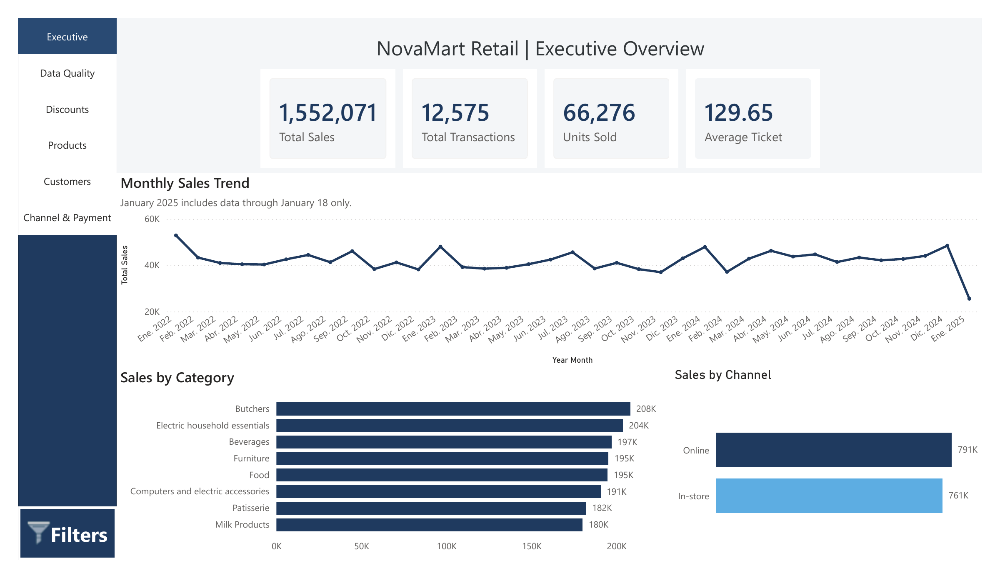

# NovaMart Retail | Sales Analytics in Power BI

**Six-page Power BI case study** on retail performance and data quality, built with a synthetic Kaggle dataset for a fictional retailer. This is a portfolio project, not client work.

[**View the report (PDF)**](reports/novamart-retail.pdf) · [Methodology](docs/methodology-and-limitations.md) · [Metric definitions](docs/metric-definitions.md)

## The business question

How can a retailer monitor sales, product performance, customers, discounts and sales channels when some transaction fields are missing?

I prepared the source data, built a dimensional model and designed a report that keeps incomplete records visible without treating unknown values as zero.

## Three findings from the dataset

1. **Recorded sales total 1,552,071** across **11,971 transactions with valid sales metrics**, giving an **average ticket of 129.65**. The source does not specify a currency. Sales amounts for the other 604 transactions are unknown, so recorded sales are not an estimate of all potential revenue.
2. **50.37% of transactions with a known discount status were discounted** (4,219 of 8,376). Another **4,199 transactions (33.39%)** have an unknown discount status. Reporting discount usage against all transactions would answer a different, misleading question.
3. **95.20% of transactions have the core metrics needed for sales analysis** (11,971 of 12,575). Cleaning recovered **609 unit prices** and **1,213 product names** without increasing the transaction count, but did not invent sales or quantities for the 604 incomplete records.

These are descriptive findings from **synthetic data**, not conclusions about a real retailer or evidence of commercial impact.

## Report pages

| Page | What it explores |
| --- | --- |
| [Executive Overview](screenshots/01-executive-overview.webp) | Recorded sales, transactions, units and trends |
| [Data Quality](screenshots/02-data-quality.webp) | Metric availability, missing data and recoveries |
| [Discount Analysis](screenshots/03-discount-analysis.webp) | Known discount statuses and usage |
| [Product Performance](screenshots/04-product-performance.webp) | Sales, units and product rankings |
| [Customer Analysis](screenshots/05-customer-analysis.webp) | Customers with transactions and activity |
| [Channel & Payment](screenshots/06-channel-payment.webp) | Sales channels and payment methods |

## How I built it

**Power BI Desktop · Power Query (M) · DAX · Dimensional modeling**

- Preserved the original **12,575 transaction rows and distinct IDs** through the product lookup, checking for ambiguous keys and join fanout.
- Derived missing unit prices from **Total Spent / Quantity** when both values were available.
- Recovered product names using **200 unique category–price lookup keys**.
- Separated valid sales transactions from incomplete ones and **Unknown** discount statuses from **No**.
- Modeled sales against five dimensions: Date, Product, Location, Customer and Payment Method.
- Updated the customer KPI to count distinct customer IDs from the fact table so it responds to report filters; the Top 10 customer ranking intentionally includes ties.

See [data cleaning](docs/data-cleaning.md), [model and relationships](docs/data-model.md), [DAX definitions](docs/metric-definitions.md), and [selected validation checks](docs/methodology-and-limitations.md).

## Dataset and limitations

Source: [Retail Store Sales: Dirty for Data Cleaning](https://www.kaggle.com/datasets/ahmedmohamed2003/retail-store-sales-dirty-for-data-cleaning), by **Ahmed Mohamed**, licensed under [CC BY-SA 4.0](https://creativecommons.org/licenses/by-sa/4.0/). I used the source to build a fictional NovaMart scenario. [Attribution and adaptations](docs/data-source-and-license.md).

The source has **25 customer IDs**, **2 locations**, no specified currency, and only partial data for January 2025 (through January 18). The PDF is static; it cannot demonstrate interactive filtering. The PBIX, raw CSVs and complete Power Query scripts are not included in this repository, so this publication is **not a fully reproducible model package**. Row-level security has not been functionally verified.

**[Explore all six pages in the PDF](reports/novamart-retail.pdf)**
